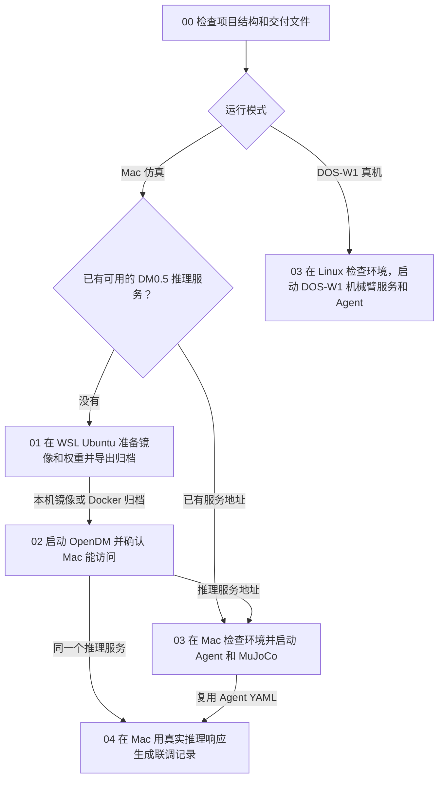
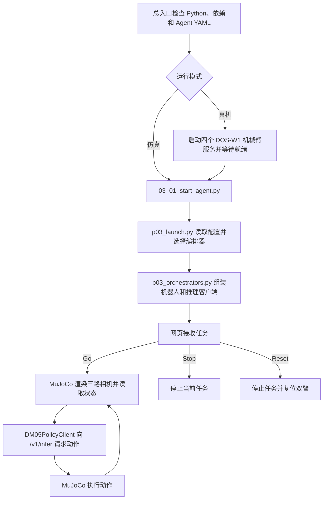

# DM0.5 Agent 仿真与推理接入

[项目目标](#项目目标) · [运行路线](#运行路线) · [Python 执行顺序](#python-执行顺序) · [Agent 调用链](#agent-调用链)

## 项目目标

项目用 MuJoCo 模拟双臂、夹爪和三路相机，由自部署的 DM0.5 推理服务给出动作。

公开版本提供 OpenDM 部署脚本和联调流程说明。Agent 源码及随附的第三方资产涉及敏感信息及保密要求，暂不公开。阶段 00–02 可按文档运行，阶段 03–04 及真机流程需要另行取得授权提供的组件。[Agent 目录说明](agent/README.md) · [第三方资产目录说明](third_party/README.md)

| 环节   | 输入                | 输出                                       |
| ---- | ----------------- | ---------------------------------------- |
| 仿真观测 | MuJoCo 场景及当前状态    | 正面、左腕、右腕图像，以及 14 维状态。每条机械臂提供六个关节角和一个夹爪开度 |
| 推理   | 任务文本、三路图像和 14 维状态 | OpenDM `/v1/infer` 返回每步 14 维的动作序列        |
| 执行   | 关节角和夹爪开度目标        | MuJoCo 执行动作，更新图像和状态                      |

Agent 通过 HTTP `POST` 调用 OpenDM 的 `/v1/infer`。请求使用 JSON，三路图像以 Base64 字符串传输。[OpenDM 接口说明](https://github.com/dexmal/opendm/blob/03f799120d425ead51d9482bb1da950b6dabade9/docs/zh/dm05_inference.md#5-调用-http-api)

DOS-W1 真机、任务编排、语音和录制各有配置。阶段 03 可以显式选择 DOS-W1 真机，依次检查环境、启动机械臂服务和启动 Agent。[DOS-W1 真机步骤](docs/dos_w1_setup_zh.md) · [编排模式与直控接口](docs/direct_low_level_usage_zh.md)

## 运行路线

先运行阶段 00 检查项目结构和交付文件。当前在 Windows 的 WSL Ubuntu 使用多核 CPU 运行 DM0.5，Mac 选用 Tailscale 接入。联调通过后再迁移到 GPU 主机。已有可访问的服务时，可以直接启动第 03 步。 [连接方式与配置](dm05_workflow/p02_inference/02_启动推理服务.md#连接方式)



| 阶段           | 完成条件                                                              | 操作说明                                                                                |
| ------------ | ----------------------------------------------------------------- | ----------------------------------------------------------------------------------- |
| 00 检查交付与查看路线 | 结构和交付文件完整性检查通过，能预览各阶段的命令和执行机器                                     | [运行顺序和配置](dm05_workflow/p00_pipeline/00_从零开始与运行路线.md)                               |
| 01 准备并打包     | 权重校验通过，得到包含模型程序、python环境、模型权重的 Docker 归档                          | [Windows 准备与外盘导出](dm05_workflow/p01_prepare/01_准备并打包.md)                            |
| 02 启动推理      | OpenDM 加载权重，Mac 能访问 `POST /v1/infer`。当前使用 Windows CPU 和 Tailscale | [启动推理服务](dm05_workflow/p02_inference/02_启动推理服务.md)                                  |
| 03 启动 Agent  | 环境和配置检查通过。Mac 网页显示三路仿真画面，可启动、停止任务和复位双臂。选择真机时，四个机械臂服务就绪后启动 Agent   | [Mac 仿真](dm05_workflow/p03_agent/03_启动仿真.md) · [DOS-W1 真机](docs/dos_w1_setup_zh.md) |
| 04 联调        | DM0.5 根据任务和仿真观测返回动作序列，首个动作提交给 MuJoCo，并生成联调记录                      | [真实推理与仿真联调](dm05_workflow/p04_integration/04_推理与仿真联调.md)                            |

### 模型打包和迁移

运行 DM0.5 需要 OpenDM 程序、训练好的权重及配套配置，以及 Python 运行环境。阶段 01 准备程序镜像、下载并校验权重，将权重装进镜像，然后导出一个 `.tar` 文件。[OpenDM 程序](https://github.com/dexmal/opendm) · [DM0.5 权重](https://huggingface.co/collections/Dexmal/dm05)

阶段 02 在目标 Ubuntu 主机导入归档并启动 OpenDM。目标主机需要 Docker、兼容的 NVIDIA 驱动和容器 GPU 支持，并使用显存足够的 GPU。[推理部署步骤](dm05_workflow/p02_inference/02_启动推理服务.md)

## Python 执行顺序

从项目根目录预览调度表生成的命令和对应的执行机器。

```bash
python3 dm05_workflow/p00_pipeline/00_02_run_pipeline.py --dry-run
```

在当前机器执行一个阶段时，用 `--from-stage N` 指定阶段。比如 `--from-stage 0` 执行交付检查，`--from-stage 3` 启动仿真，`--from-stage 3 --dos-w1` 选择 Linux 真机流程。真机和仿真都可以用 `--agent-config` 指定本次启动的 Agent YAML。[完整运行说明](dm05_workflow/p00_pipeline/00_从零开始与运行路线.md)

| 入口                                                                     | 主要输入                            | 主要输出                                        |
| ---------------------------------------------------------------------- | ------------------------------- | ------------------------------------------- |
| [00_01 检查结构与完整性](dm05_workflow/p00_pipeline/00_01_check_structure.py)  | 阶段目录、标准配置、调度表、`MANIFEST.sha256` | 结构和交付文件校验结果                                 |
| [00_02 总入口](dm05_workflow/p00_pipeline/00_02_run_pipeline.py)          | 工作流 JSON 和阶段范围                  | 路线预览或当前阶段的执行结果                              |
| [01_01 准备镜像和权重](dm05_workflow/p01_prepare/01_01_prepare_opendm.py)     | 官方基础镜像、固定版本源码和权重                | `opendm-dm05:prepared` 和 `checkpoints/DM05` |
| [01_02 打包并导出](dm05_workflow/p01_prepare/01_02_export_image.py)         | 程序镜像、权重目录                       | `opendm-dm05:with-weights` 和 `.tar` 归档      |
| [02_01 导入归档](dm05_workflow/p02_inference/02_01_import_image.py)        | Docker 归档                       | GPU 主机上的 `opendm-dm05:with-weights` 镜像      |
| [02_02 启动推理服务](dm05_workflow/p02_inference/02_02_start_inference.py)   | 本机镜像和 NVIDIA GPU                | 端口 `7891` 上的 OpenDM 推理服务                    |
| [03_01 启动 Agent](dm05_workflow/p03_agent/03_01_start_agent.py)         | Agent YAML，可选 `--fixed-task`    | 常规或固定任务网页                                   |
| [04_01 检查联调](dm05_workflow/p04_integration/04_01_check_integration.py) | Agent YAML、仿真观测、真实推理服务          | `outputs/integration.json`                  |

总入口在阶段 03 先检查 CPython 3.11、所选环境的依赖和实际使用的 Agent YAML。真机分支随后启动机械臂服务并等待四个端口就绪，再调用 `03_01_start_agent.py`。[环境检查实现](dm05_workflow/p03_agent/_impl/p03_verify_runtime.py) · [真机服务启动实现](dm05_workflow/p03_agent/_impl/p03_start_dos_w1.sh)

总入口根据工作流配置中的 `fixed_task` 决定在第 03 步是否传入 `--fixed-task`。第 04 步使用工作流 JSON 的 `agent_config`，可以从另一个终端运行。

### Agent 调用链



[启动逻辑](dm05_workflow/p03_agent/_impl/p03_launch.py) · [编排器组装](dm05_workflow/p03_agent/_impl/p03_orchestrators.py) · [Agent 目录说明](agent/README.md)

## 项目结构

`configs/` 存放工作流配置。`dm05_workflow/` 存放分步说明和按 `阶段_步骤_功能.py` 编号的入口，入口导入各阶段 `_impl/` 中的实现。机器人、推理客户端、编排器和网页位于 `agent/`。[标准配置](configs/standard.json)
